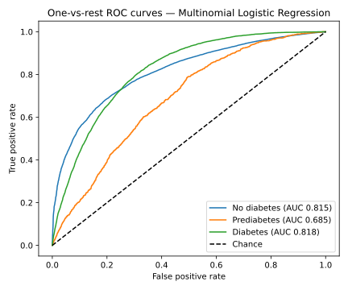
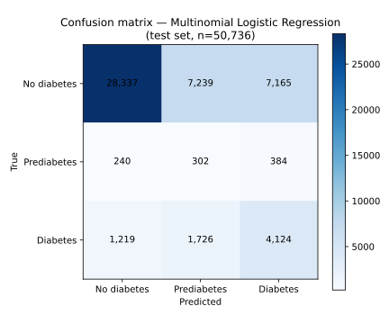
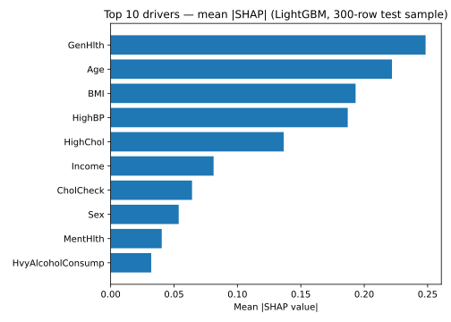

# CDC Diabetes Risk Prediction

🚀 **Live demo:** [Try the app](https://dmpcges8zubzu8psyweucw.streamlit.app/)

Predict diabetes status from self-reported health indicators — no
diabetes, prediabetes, or diabetes — and be honest about how hard the
rare class is to catch.

> ⚠️ **This is an educational portfolio project using self-reported
> survey data, not a medical diagnosis tool. It must not be used for
> clinical decisions.** The data are telephone-survey answers, not lab
> results, and the model is far from good enough to screen anyone.

## Results (test set, n = 50,736)

Stratified 80/20 train/test split (`random_state=42`) on the full
253,680-row dataset. The honest headline is **macro-F1, not accuracy**:
a classifier that always predicts "No diabetes" scores 84.2% accuracy
and finds zero cases. Balanced class weights trade accuracy for recall
of the minority classes.

| Model | Accuracy | Macro-F1 | OvR ROC-AUC (macro) | Brier |
|---|---|---|---|---|
| **Multinomial Logistic Regression** | 0.6458 | **0.4269** | **0.7728** | 0.4896 |
| XGBoost | 0.6431 | 0.4245 | 0.7643 | 0.4626 |
| LightGBM | 0.6339 | 0.4215 | 0.7646 | 0.4671 |
| Majority-class baseline | 0.8424 | 0.3048 | 0.5000 | 0.3152 |

Per-class results (Logistic Regression, the best model by macro-F1):

| Class | Precision | Recall | F1 | OvR ROC-AUC |
|---|---|---|---|---|
| No diabetes (84.2%) | 0.951 | 0.663 | 0.781 | 0.815 |
| Prediabetes (1.8%) | 0.033 | 0.326 | 0.059 | 0.685 |
| Diabetes (13.9%) | 0.353 | 0.583 | 0.440 | 0.818 |

### The honest finding: prediabetes is nearly undetectable here

Prediabetes is only 1.8% of respondents, and even with a class weight
of 18× the best model finds only a third of cases — and 97% of its
prediabetes predictions are wrong (precision 0.033). Diabetes itself
is caught better (recall 0.58–0.64, OvR AUC ~0.82), and collapsing
the problem to binary (any diabetes vs none) gives ROC-AUC 0.81–0.82
with recall ~0.82–0.84 at precision ~0.31. Self-reported survey
answers (general health, BMI, age, blood pressure) simply do not
separate prediabetes from healthy respondents. Reporting that is the
point of this project — a model that quietly predicted "no diabetes"
for everyone would look 84% accurate and be useless.

Reproduce: `python src/train.py` — it prints these numbers and writes
`metrics.json` plus the plots in `plots/`.

## Modern baseline comparison (TabICLv2)

We also tested a modern tabular foundation model as an extra
comparison — **TabICLv2** (`tabicl.TabICLClassifier`, default
checkpoint `tabicl-classifier-v2-20260212.ckpt`). It conditions on the
training rows in a single forward pass (in-context learning) instead
of training weights. Because the full-size run does not fit this
machine's memory, the comparison uses a stratified subsample: 6,000
rows drawn from the full dataset, split 5,000 train / 1,000 test
(`random_state=42`). The same subsample, split and metrics were used
for a multinomial Logistic Regression baseline. A 10,000/2,000
subsample was tried first and the run was killed by the Linux OOM
killer during TabICL prediction on this 1.5-CPU / 6 GB machine, so
the numbers below are from the 5,000/1,000 run.

| Model (subsample, test n = 1,000) | Accuracy | Macro-F1 | OvR ROC-AUC (macro) | Brier | Predict time |
|---|---|---|---|---|---|
| TabICLv2 | 0.842 | 0.378 | 0.736 | 0.078 | 18 min |
| Logistic Regression | 0.583 | 0.375 | 0.721 | 0.178 | < 1 s |

The honest reading: it is a statistical tie on macro-F1 (0.378 vs
0.375) with a small OvR AUC edge for TabICLv2 — but TabICLv2
predicted "prediabetes" for **nobody** (recall 0.0 on 18 test cases)
and found only 14% of diabetes cases, while the class-weighted
Logistic Regression found 53% of diabetes cases and 11% of
prediabetes. TabICLv2 has no class weighting, so on this extremely
imbalanced problem it collapses toward the majority class, and its
low Brier score mostly reflects conservative probabilities, not
better detection. It also took 18 minutes to predict 1,000 rows
versus under a second for Logistic Regression. A newer model is not
automatically a better model for this problem — running the
comparison is the point.

Reproduce: `python src/foundation_comparison.py` (needs the optional
`tabicl` dependency; the checkpoint is downloaded at runtime and is
not bundled in this repository).

**Licence:** TabICLv2 is used under the **BSD 3-Clause License,
Copyright (c) 2025, Soda team @ Inria** — a permissive open-source
licence with no use-case restrictions, verified in the installed
`tabicl` 2.2.0 package LICENSE file. Project:
https://github.com/soda-inria/tabicl. TabPFN-3/3.5 was deliberately
**not** used: its weights carry a non-commercial licence. No model
weights are bundled in this repository.





## What drives the prediction? (SHAP, LightGBM, 300-row test sample)

Mean |SHAP value| — top 5:

1. **GenHlth** (0.248) — self-rated general health (1 = excellent … 5 = poor)
2. **Age** (0.222)
3. **BMI** (0.193)
4. **HighBP** (0.187) — told by a doctor they have high blood pressure
5. **HighChol** (0.137)

## Fairness check (best model, test set)

Diabetes recall is much lower for younger respondents — the model
misses most cases where diabetes is rare:

| Group | Diabetes recall | Prediabetes recall | True diabetes share |
|---|---|---|---|
| Age 18–44 | 0.30 | 0.15 | 4.0% |
| Age 45–64 | 0.55 | 0.33 | 13.4% |
| Age 65+ | 0.64 | 0.36 | 20.8% |
| Female | 0.53 | 0.36 | 13.0% |
| Male | 0.64 | 0.28 | 15.1% |

A screening tool built on this data would under-detect diabetes in
younger adults and in women. That is a reason not to deploy it, and
the reason the fairness check is in this README.

## Method

- **Data:** CDC Diabetes Health Indicators, BRFSS 2015 (UCI #891),
  253,680 rows, 21 features, no missing values. Target `Diabetes_012`:
  0 = no diabetes (213,703 / 84.2%), 1 = prediabetes (4,631 / 1.8%),
  2 = diabetes (35,346 / 13.9%).
- **Split:** stratified 80/20, so train and test keep the same class mix.
- **Imbalance:** class weights `balanced` (Logistic Regression,
  LightGBM) and per-sample weights (XGBoost); prediabetes weight ≈ 18×.
- **Models:** multinomial Logistic Regression (standardised features),
  XGBoost (300 trees, depth 6) and LightGBM (300 trees, 31 leaves).
- **Evaluation:** per-class Precision / Recall / F1, macro-F1, one-vs-rest
  ROC-AUC and multiclass Brier score. Accuracy is reported only to show
  why it misleads here.
- **Calibration:** Brier scores are 0.46–0.49 for the real models — the
  predicted probabilities are poorly calibrated, another reason this
  model must not be used for individual decisions.

## Dataset

CDC Behavioral Risk Factor Surveillance System (BRFSS) 2015, cleaned
to 21 health indicators by the UCI Diabetes Health Indicators dataset
(#891). The file used here is `diabetes_012_health_indicators_BRFSS2015.csv`
(253,680 rows). Sources:

- UCI dataset page: https://archive.ics.uci.edu/dataset/891/cdc+diabetes+health+indicators
- Kaggle mirror: https://www.kaggle.com/datasets/alexteboul/diabetes-health-indicators-dataset
- Download mirror used by `src/train.py`: https://raw.githubusercontent.com/ucb-stat-159-s23/project-group25/main/data/diabetes_012_health_indicators_BRFSS2015.csv

The bundled `data/diabetes_sample.csv` is a stratified 20,000-row
sample (16,848 / 365 / 2,787). The full 23 MB file is gitignored and
downloaded by `src/train.py` at runtime if missing.

> **Honest note:** these are **self-reported survey answers** from a
> telephone survey — general health, smoking, fruit/vegetable intake,
> income, education — not lab tests, not a clinical cohort, and not a
> representative sample of any other country's population. The value
> here is the method (stratified evaluation under extreme imbalance,
> per-class and fairness reporting, calibration, explainability) applied
> transparently, not a claim that survey answers can diagnose diabetes.

## Demo

```bash
pip install -r requirements.txt
streamlit run app.py
```

The demo trains the LightGBM model in memory on the bundled 20,000-row
sample and shows predicted probabilities for the three classes from
health indicators you enter — with the same not-a-diagnosis disclaimer.

## Project structure

```
├── app.py                  # Streamlit demo (trains on the bundled sample)
├── data/
│   ├── diabetes_sample.csv # stratified 20,000-row sample (bundled)
│   └── diabetes_012_full.csv  # full 253,680-row file (gitignored, downloaded)
├── metrics.json            # measured test-set results (from src/train.py)
├── plots/
│   ├── confusion_matrix.svg
│   ├── roc_curves.svg
│   └── shap_top_drivers.svg
├── requirements.txt
└── src/
    ├── train.py            # loading, training, evaluation, fairness, SHAP
    ├── foundation_comparison.py  # TabICLv2 vs Logistic Regression (subsample)
    └── download_checkpoint.py   # downloads the TabICLv2 checkpoint (not bundled)
```

## Limitations

- Prediabetes detection is poor (F1 ≈ 0.06) — the headline result,
  not a footnote.
- Probabilities are poorly calibrated (Brier ≈ 0.46–0.49).
- Recall varies sharply by age and sex; the model under-detects
  diabetes in younger adults.
- Self-reported data: BMI, blood pressure and cholesterol are what
  respondents *said*, not what was measured.
- Single dataset, single split — no external validation on another
  population or year.
- **Not a medical device, not a screening tool, not a diagnosis.**
